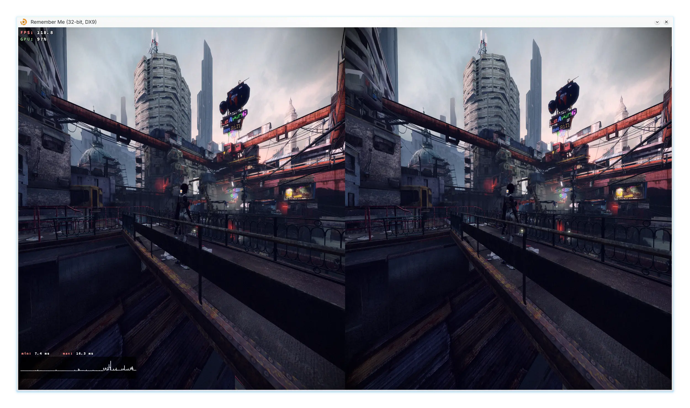

VR mod for Remember Me.

## Features

- stereo rendering and head tracking
- Floating menus, HUD and subtitles on their own panel
- VR controllers support (not that great for gameplay though)
- Config UI for most settings
- Free cam, options to hide the player, NPCs and Sensen hints.
- Unlock mouse in menus and skip intro disable motion blur

### Hotkeys

| Key | Action |
|---|---|
| F6 (or both analog stick clicks) | Open/close the config menu |
| F8 | Recenter the view |
| F9 | Dump the engine's object list (development) |
| F10 | Toggle the flat side-by-side test (development) |

Keys and all other options are in `RememberMeVR.ini`; see [configuration](meta/docs/configuration.md).

## Install

1. Extract the release zip into the game's install folder (it puts `dinput8.dll` and `RememberMeVR.ini` in `Binaries/Win32`).
2. Start SteamVR (or another OpenXR runtime) **before** the game.
3. **Windows** needs [DXVK](https://github.com/doitsujin/dxvk/releases)'s 32-bit `d3d9.dll`. **Linux/Proton** also needs a launch option and a one-time OpenXR manifest; 

Details: [Linux / Proton](meta/docs/installing-linux.md) / [Windows](meta/docs/installing-windows.md)

## Development

[Documentation index](meta/docs/README.md): [repository layout](meta/docs/layout.md), [building](meta/docs/building.md), [testing](meta/docs/testing.md), [packaging](meta/docs/packaging.md), [adding another game](meta/docs/adding-a-game.md).

## License

zlib; see [LICENSE](LICENSE).
